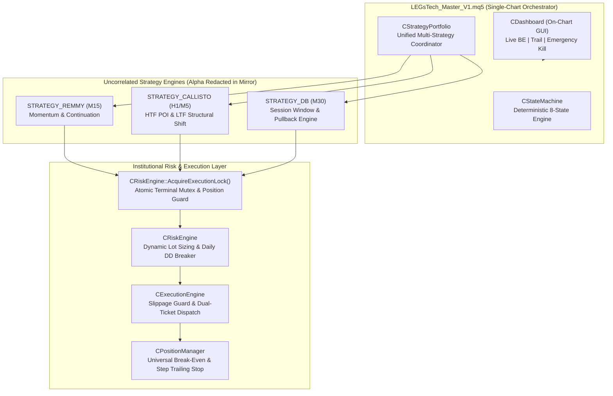

# LEGsTECH Institutional Quantitative Trading Engine (`XAUUSD`)

[-0066FF?style=flat-square)](#)
[-FFB800?style=flat-square)](#)
[](#)

> **Institutional-Grade Multi-Strategy MQL5 Execution Engine, Cross-Chart Concurrency Mutex, and Real-Time Capital Preservation Suite for Gold (`XAUUSD`).**

---

## 🔒 Intellectual Property & Public Mirror Notice

This repository contains the **complete institutional systems engineering, execution engine, cross-chart concurrency mutex, portfolio coordinator, position manager, and on-chart GUI dashboard** of the **LEGsTECH Quantitative Trading Engine**.

To protect live trading alpha on funded institutional accounts, the proprietary mathematical entry weights and multi-timeframe regime thresholds inside `StrategyRemmy.mqh`, `StrategyCallisto.mqh`, and `StrategyDB.mqh` are redacted with clean compilable baseline interfaces (`// [PROPRIETARY ALPHA REDACTED IN PUBLIC MIRROR]`). All structural OOP interfaces, dependency injection wiring, finite state machines (`CStateMachine`), indicator handle lifecycles, and execution mutexes remain **100% intact and compilable**.

---

## 🏗️ System Architecture



---

## ⚡ Key Engineering Pillars

### 1. Atomic Cross-Chart Execution Mutex (`CRiskEngine::AcquireExecutionLock`)
In MetaTrader 5, running multiple strategies or chart instances simultaneously introduces a classic concurrency **race condition**: during high-velocity macro spikes (e.g., CPI/NFP on `XAUUSD`), two threads can query `PositionsTotal()` within the same millisecond, both observe `0` open positions, and both dispatch market orders—violating `InpMaxPositions` and doubling account risk exposure.

`Include/LEGsTech/Engine/RiskEngine.mqh` eliminates this race condition via an atomic terminal-level lock (`LEGsTech_Lock_<Symbol>`) backed by MT5 Global Variables with a deterministic 5-second deadlock timeout guard:
```cpp
// Acquire Cross-Chart Execution Mutex before dispatching any order
if(!m_riskEngine.AcquireExecutionLock(3))
{
   LogState("Execution BLOCKED: Another chart instance is executing orders on this symbol.");
   return false;
}
// Dispatch single or dual (Banker + Runner) position
executed = m_execEngine.ExecuteDualPositionOrder(...);
m_riskEngine.ReleaseExecutionLock();
```

### 2. Unified Single-Chart Portfolio (`CStrategyPortfolio`)
Rather than attaching three separate EAs across three charts, `STRATEGY_PORTFOLIO` (`Include/LEGsTech/Strategies/StrategyPortfolio.mqh`) coordinates all three uncorrelated engines from a **single chart instance**:
- **`STRATEGY_REMMY` (`PERIOD_M15`)**: Intraday momentum and fractal continuation engine.
- **`STRATEGY_CALLISTO` (`PERIOD_H1` / `PERIOD_M5`)**: Higher-timeframe Point-of-Interest (POI) & lower-timeframe confirmation engine.
- **`STRATEGY_DB` (`PERIOD_M30`)**: Session-window breakout and counter-trend pullback reset engine.

### 3. Capital Preservation & Active Position Management (`CPositionManager`)
- **Universal Break-Even Engine**: Automatically locks Stop Loss at `Entry + 2.0 pips` (configurable) once floating profit reaches `+50.0 pips`.
- **Dynamic Step-Based Trailing Stop**: Engages at `+30.0 pips` profit, trailing price at a `20.0-pip` distance in `5.0-pip` ratcheting steps.
- **Daily Drawdown Circuit Breaker**: Continuously monitors realized + floating daily PnL against `InpMaxDailyLossPercent`, halting new entries and protecting prop-firm daily drawdown limits.
- **On-Chart Interactive GUI (`CDashboard`)**: Real-time telemetry panel with 1-click live toggles for **Break-Even**, **Trailing Stop**, and **Emergency Kill (Flatten All)**.

### 4. 24/7 Cloud VPS & Automated Telegram Forensics
Deployed in production on an **AWS Lightsail Windows Server 2025 VPS** (`eu-west-3a`) paired with an automated **Python Telegram Forensics Daemon** that parses MT5 journal/trade logs nightly and pushes real-time execution and risk telemetry.

---

## 📂 Repository Structure

```text
├── CLAUDE.md                                      # Agentic AI / Claude Code architectural instructions & build specs
├── Experts/
│   └── LEGsTech_Master_V1.mq5                     # Main MQL5 Expert Advisor entrypoint
└── Include/LEGsTech/
    ├── Core/
    │   ├── BaseStrategy.mqh                       # Abstract base strategy with FSM & indicator lifecycle
    │   ├── Defs.mqh                               # Institutional structs, enums, and configuration models
    │   ├── Logger.mqh                             # Ring-buffered multi-channel JSON/console logger
    │   └── StateMachine.mqh                       # Deterministic 8-state finite state machine
    ├── Engine/
    │   ├── ExecutionEngine.mqh                    # OrderSend wrapper with filling-mode & retry guards
    │   ├── PositionManager.mqh                    # Universal Break-Even, Trailing Stop & dual-ticket manager
    │   ├── RiskEngine.mqh                         # Cross-chart execution mutex, lot sizing & DD circuit breaker
    │   └── SymbolHelper.mqh                       # Multi-asset pip/point/tick-value normalization
    ├── Indicators/
    │   ├── FractalDetector.mqh                    # 5-bar Bill Williams fractal & swing scanner
    │   ├── FVGDetector.mqh                        # Fair Value Gap & imbalance detector
    │   ├── SessionFilter.mqh                      # GMT/UTC session window & pullback counter
    │   └── StructureDetector.mqh                  # BOS / CHoCH / Engulfing structural detector
    ├── Strategies/
    │   ├── IStrategy.mqh                          # Core strategy contract interface
    │   ├── StrategyPortfolio.mqh                  # Multi-strategy single-chart portfolio orchestrator
    │   ├── StrategySelector.mqh                   # Factory selector for individual vs. portfolio modes
    │   ├── StrategyRemmy.mqh                      # M15 engine (execution/FSM intact, alpha weights redacted)
    │   ├── StrategyCallisto.mqh                   # H1/M5 engine (execution/FSM intact, alpha weights redacted)
    │   └── StrategyDB.mqh                         # M30 engine (execution/FSM intact, alpha weights redacted)
    └── UI/
        ├── Dashboard.mqh                          # Interactive on-chart glassmorphic control panel
        └── Theme.mqh                              # Design tokens & formatting utilities
```

---

## 🛠️ Compilation & Verification

Compile headlessly using the MetaEditor 64-bit CLI (`0 errors, 0 warnings` policy):
```powershell
& "C:\Program Files\MetaTrader 5\metaeditor64.exe" /compile:"Experts\LEGsTech_Master_V1.mq5" /inc:"." /log:"compile.log"
Get-Content compile.log
```

---

## 👤 Author
**Tony Sadzi Johnson** — *Quantitative & AI Systems Developer | FinTech Operations Specialist*  
🌐 [Portfolio](https://tonnylegacy.github.io) | 💻 [GitHub](https://github.com/tonnylegacy) | 🔗 [LinkedIn](https://www.linkedin.com/in/tony-sadzi-johnson-067810250/)
